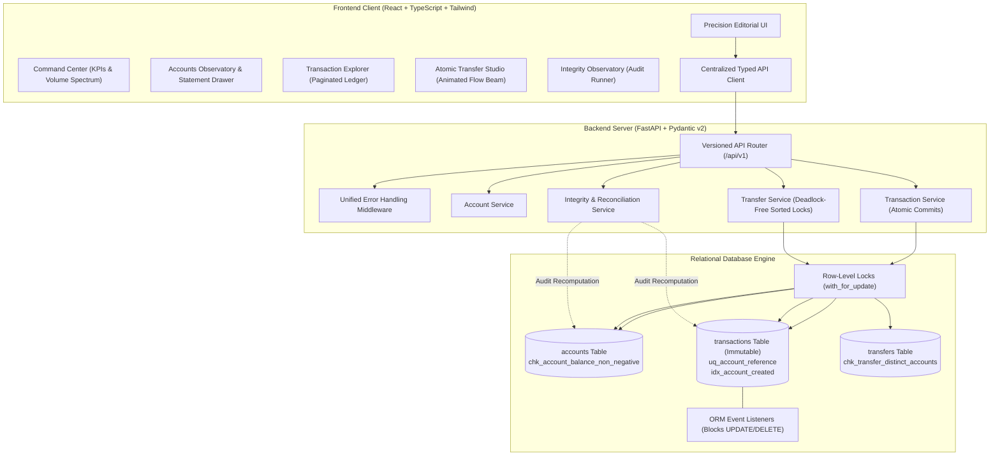

# LEDGER//ONE — The Transaction Integrity Console

> **"Every balance has a reason."**  
> A high-assurance financial transaction management platform engineered for mathematical accuracy, atomic balance updates, immutable audit trails, and real-time ledger reconciliation.

[]()
[]()
[]()
[]()

---

## 1. Executive Summary & Product Vision

Most banking and transaction dashboards are generic CRUD applications with synthetic data, floating cards, and purple gradients. **LEDGER//ONE** is designed from first principles as a **financial operations terminal**:

1. **Every financial movement is explainable**: Balances are not just arbitrary database values; every balance reconciles with the raw transaction journal down to the exact cent.
2. **Every transaction has an immutable identity**: Once created, transactions cannot be updated or deleted via the API or ORM.
3. **Atomicity by design**: Balance mutation and transaction insertion succeed or fail as one atomic operation.
4. **Concurrency safe**: Row-level locking (`SELECT ... FOR UPDATE` on PostgreSQL / WAL serialized write locks) prevents race conditions and overdrafts.
5. **Deadlock-free atomic transfers**: Bonus multi-account transfers acquire row-level locks in deterministic UUID-sorted order.
6. **Zero fake metrics**: Every figure, chart bar, and status badge displayed in the console reflects real, verified database state.

---

## 2. System Architecture



---

## 3. Technology Stack

### Backend
- **Framework**: Python 3.10+, FastAPI (Asynchronous REST API)
- **ORM & Data Access**: SQLAlchemy 2.0 (Modern Type-Safe Mappings)
- **Data Validation**: Pydantic v2 (Strict decimal parsing, whitespace trimming, bounds validation)
- **Database Migrations**: Alembic
- **Relational Databases**: 
  - **PostgreSQL 16**: Primary production target with connection pooling and `SELECT ... FOR UPDATE` row locks.
  - **SQLite**: Zero-dependency local development target with WAL journaling and foreign key enforcement.
- **Testing**: Pytest, Pytest-Asyncio, HTTPX TestClient (13 unit, integration, and concurrency tests).

### Frontend
- **Framework**: React 18, TypeScript, Vite
- **Styling**: Tailwind CSS with custom **Precision Editorial** design tokens (`#0B0D0E`, `#C7F36B`, `#FF7474`, `#F3BD68`)
- **Visualizations**: Recharts (Dynamic Credit vs Debit volume spectra)
- **Icons**: Lucide React
- **Custom Precision Cursor**: Optional desktop tracking dot with interactive hover states (honors `prefers-reduced-motion`).

---

## 4. Repository Structure

```
├── backend/
│   ├── alembic/                # Database migrations
│   ├── app/
│   │   ├── api/v1/             # REST API routers (accounts, transactions, transfers, integrity)
│   │   ├── core/               # Configuration, custom exceptions, error handlers
│   │   ├── db/                 # Database engine, session, seeding script
│   │   ├── models/             # SQLAlchemy ORM models with immutability guards
│   │   ├── schemas/            # Pydantic v2 schemas and decimal validation
│   │   ├── services/           # Business logic (atomic transaction & transfer engines)
│   │   └── main.py             # FastAPI entrypoint with CORS and lifespan
│   ├── tests/
│   │   ├── unit/               # Pydantic validation & immutability unit tests
│   │   ├── integration/        # Full lifecycle, pagination, and rollback tests
│   │   └── concurrency/        # Threaded concurrent debit and race-condition tests
│   ├── Dockerfile
│   └── requirements.txt
├── frontend/
│   ├── src/
│   │   ├── api/                # Typed API client with unified error handling
│   │   ├── components/
│   │   │   ├── accounts/       # Observatory, account provisioning, statement timeline
│   │   │   ├── dashboard/      # Command center, KPI tickers, volume chart
│   │   │   ├── integrity/      # Real-time mathematical reconciliation audit
│   │   │   ├── layout/         # Precision header, navigation tabs, custom cursor
│   │   │   ├── transactions/   # Paginated explorer, composer, 5-step lifecycle inspector
│   │   │   ├── transfers/      # Connected node transfer studio with directional flow beam
│   │   │   └── ui/             # Stat cards, modal dialogs, status badges, toasts
│   │   ├── styles/             # Tailwind & custom keyframes
│   │   ├── types/              # Domain TypeScript interfaces
│   │   ├── App.tsx             # Main application container
│   │   └── main.tsx            # React mounting
│   ├── Dockerfile
│   └── package.json
├── docs/
│   ├── API.md                  # Comprehensive API documentation & sample requests
│   └── ASSUMPTIONS.md          # Architectural assumptions, currency policy & invariants
├── docker-compose.yml          # One-command full-stack container orchestration
├── .gitignore
└── README.md                   # This document
```

---

## 5. Prerequisites & Local Setup

### Option A: Local Development (Fastest, zero external dependencies)

#### 1. Setup Backend
```bash
# From repository root
python -m venv venv

# Activate venv:
# Windows (PowerShell):
.\venv\Scripts\Activate.ps1
# macOS/Linux:
source venv/bin/activate

# Install dependencies
pip install -r backend/requirements.txt

# Run migrations and seed sample accounts
cd backend
python -m app.db.seed

# Start backend server (runs on http://localhost:8000)
uvicorn app.main:app --reload --port 8000
```

#### 2. Setup Frontend
```bash
# In a new terminal window
cd frontend

# Install node dependencies
npm install

# Start Vite dev server (runs on http://localhost:5173)
npm run dev
```

Visit **http://localhost:5173** to launch the Console!  
Interactive Swagger API documentation is available at **http://localhost:8000/docs**.

---

### Option B: Docker Compose (Full Stack with PostgreSQL)

Ensure Docker Desktop is running:
```bash
docker compose up --build
```
- Frontend: **http://localhost:5173**
- Backend: **http://localhost:8000**
- PostgreSQL: **localhost:5432**

---

## 6. Financial Integrity Invariants & Engineering Guarantees

### 1. Atomic Transaction Creation & Balance Consistency
Creating a transaction and updating the account balance are treated as one single atomic operation:
```python
# Acquire row-level lock on account
account = db.query(Account).filter(Account.id == data.account_id).with_for_update().first()

# Validate balance sufficiency for debits
if data.type == "debit" and account.balance < amount:
    raise InsufficientBalanceError(...)

# Create immutable transaction entry
tx = Transaction(...)
db.add(tx)

# Mutate balance atomically
account.balance += (amount if data.type == "credit" else -amount)

# Commit or rollback atomically
db.commit()
```
If anything fails (such as duplicate reference or check constraint), the entire session rolls back cleanly without leaving orphan balance mutations.

### 2. Transaction Immutability
Once written to the ledger, transactions cannot be altered or removed:
- No `PUT`, `PATCH`, or `DELETE` endpoints exist.
- SQLAlchemy event listeners hook directly into the ORM engine:
  ```python
  @event.listens_for(Transaction, "before_update")
  def guard_transaction_immutability_update(mapper, connection, target):
      raise TransactionImmutabilityError("update")

  @event.listens_for(Transaction, "before_delete")
  def guard_transaction_immutability_delete(mapper, connection, target):
      raise TransactionImmutabilityError("delete")
  ```

### 3. Concurrency Safety & Race Condition Protection
- Concurrent debits against the same account are serialized using row-level locking (`with_for_update()`).
- In automated test `test_concurrent_debits_prevent_overspend`, two concurrent threads attempt to debit $80 each from an account with only $100. Exactly one succeeds, one fails with `INSUFFICIENT_BALANCE`, and the final balance is verified to be $20, never negative.

### 4. Deterministic Deadlock-Free Transfers
When transferring funds between two accounts, locks are acquired in sorted order:
```python
first_id, second_id = sorted([source_id, dest_id])
db.query(Account).filter(Account.id == first_id).with_for_update().first()
db.query(Account).filter(Account.id == second_id).with_for_update().first()
```
This guarantees that simultaneous opposing transfers ($A \rightarrow B$ and $B \rightarrow A$) will never deadlock.

### 5. Mathematical Ledger Reconciliation (Integrity Observatory)
The `/api/v1/integrity` endpoint independently calculates:
$$\text{Calculated Balance} = \text{Opening Balance} + \sum \text{Credits} - \sum \text{Debits}$$
and compares it with the account's recorded balance. The test `test_reconciliation_detects_out_of_band_discrepancy` verifies that if an account's balance is tampered with out-of-band in the database, the Integrity Observatory immediately detects and isolates the discrepancy.

---

## 7. Automated Test Suite

All 13 automated tests can be executed with Pytest:

```bash
cd backend
..\venv\Scripts\python -m pytest -v
```

### Verified Test Summary:
| Test File | Test Case | Description | Result |
| :--- | :--- | :--- | :---: |
| `test_concurrency.py` | `test_concurrent_debits_prevent_overspend` | Multi-threaded race condition preventing overdraft | **PASSED** |
| `test_concurrency.py` | `test_concurrent_duplicate_reference` | Race condition on duplicate references | **PASSED** |
| `test_api_workflows.py` | `test_complete_financial_lifecycle` | Initial 0 -> Cr 100 -> Cr 50 -> Dr 30 -> Dr 20 = 100.00 | **PASSED** |
| `test_api_workflows.py` | Transfer bonus test | Trf 30 from A(100) to B(50) -> A=70, B=80 | **PASSED** |
| `test_immutability.py` | `test_transaction_update_raises_error` | Verifies ORM rejects transaction modifications | **PASSED** |
| `test_immutability.py` | `test_transaction_delete_raises_error` | Verifies ORM rejects transaction deletions | **PASSED** |
| `test_validation.py` | `test_amount_validation` | Validates positive decimals, rejects >2 decimal places | **PASSED** |
| `test_validation.py` | `test_account_create_validation` | Rejects blank or whitespace account names | **PASSED** |
| `test_validation.py` | `test_transaction_create_validation` | Enforces credit/debit types and reference presence | **PASSED** |
| `test_validation.py` | `test_transfer_create_validation` | Validates transfer parameters | **PASSED** |
| `test_additional_edge_cases.py` | `test_pagination_validation_errors` | Validates page >= 1, 1 <= limit <= 100 | **PASSED** |
| `test_additional_edge_cases.py` | `test_nonexistent_account_rejection` | Returns 404 ACCOUNT_NOT_FOUND | **PASSED** |
| `test_additional_edge_cases.py` | `test_reconciliation_detects_out_of_band_discrepancy` | Flags unauthorized out-of-band balance tampering | **PASSED** |
| `test_additional_edge_cases.py` | `test_transfer_insufficient_funds_rollback` | Confirms rollback of both balances on failed transfer | **PASSED** |

---

## 8. Interactive Features & Signature UX

1. **Transaction Lifecycle Inspector**: Open any transaction row to inspect a 5-step visual replay tracing the verified execution from validation to atomic database commit and balance reconciliation.
2. **Atomic Transfer Studio**: Interactive topology showing Source Account Node $\rightarrow$ Directional Animated Flow Beam $\rightarrow$ Destination Account Node, with real-time pre-flight balance projection.
3. **Integrity Observatory**: One-click live audit runner that executes independent recomputation and displays an account-by-account breakdown.
4. **Precision Cursor Treatment**: Restrained, responsive cursor indicator on desktop that responds to interactive buttons and table rows (with accessible toggle in the header).
5. **Deterministic Explorer**: Sorts transactions strictly latest-first based on `created_at` with deterministic ID tiebreaker, filterable by account, transaction type, and reference ID.

---

## 9. Assumptions & Constraints

Detailed documentation of all architectural choices, currency policies, and isolation semantics is available in:
- [docs/ASSUMPTIONS.md](docs/ASSUMPTIONS.md)
- [docs/API.md](docs/API.md)
